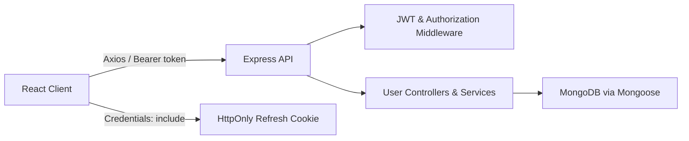

# User Management System

[](https://react.dev/)
[](https://vite.dev/)
[](https://nodejs.org/)
[](https://www.mongodb.com/)
[](./LICENSE)

A full-stack MERN application for secure authentication and role-based user management.

**Quick Links:** [Documentation](./server/README.md) | [Swagger API](http://localhost:5000/api-docs) | [Report Bug](https://github.com/IFFAT12375/user-management-system/issues) | [Request Feature](https://github.com/IFFAT12375/user-management-system/issues)

## The Problem and the Solution

### Problem

Applications that expose account data need a reliable way to authenticate users, restore sessions, and restrict administrative operations. Without clear role boundaries and consistent API validation, account management can become difficult to secure and maintain.

### Solution

User Management System provides registration and login flows, protected routes, refreshable sessions, and a paginated user administration interface. The server separates authentication, middleware, validation, and user management concerns while enforcing Admin-only create, update, and delete operations.

### Motivation

The project was built to learn authentication and authorization and how to manage real user data, including the architecture of a full-stack application.

## Key Features

- Register regular users and log in with email and password.
- Restore authenticated sessions using an HttpOnly refresh-token cookie and short-lived access token.
- Protect frontend routes and backend endpoints against unauthenticated access.
- Enforce `Admin` authorization for creating, updating, and deleting users.
- Create, view, edit, and delete user records through a React interface.
- Paginate the user table at five records per page.
- Validate API request data with Express Validator.
- Hash passwords with bcrypt and store unique, role-based user records in MongoDB.
- Explore and test API operations through Swagger UI.

## Tech Stack

| Layer | Technology |
| --- | --- |
| Frontend | React 19, React Router, Axios, Context API, Vite |
| Backend | Node.js, Express 5 |
| Database | MongoDB, Mongoose |
| Authentication | JSON Web Tokens, bcrypt/bcryptjs, HttpOnly cookies |
| API Documentation | Swagger UI, OpenAPI 3.0.3 |
| Testing/Tooling | ESLint, Nodemon |

## Requirements

### Functional Requirements

- **FR-1:** Users can register and receive a regular `User` role.
- **FR-2:** Users can log in and receive an access token.
- **FR-3:** Users can refresh an access token and restore their session.
- **FR-4:** Users can log out and clear the refresh-token cookie.
- **FR-5:** Authenticated users can retrieve their profile and list user records.
- **FR-6:** Authenticated Admin users can create, update, and delete user records.
- **FR-7:** The frontend provides protected login, registration, and user-management views.
- **FR-8:** The user table paginates records and displays available view, edit, and delete actions.
- **FR-9:** API request bodies and route parameters are validated before processing.
- **FR-10:** API operations are documented in Swagger UI.

### Non-Functional Requirements

- **NFR-1:** Passwords must be hashed before storage.
- **NFR-2:** Session refresh tokens must be stored in HttpOnly cookies.
- **NFR-3:** Protected operations must reject missing or invalid authentication.
- **NFR-4:** User mutations must enforce the `Admin` role on the server.
- **NFR-5:** Registration must assign `User` rather than allowing callers to select a role.
- **NFR-6:** The API must use consistent success and error response structures.
- **NFR-7:** The interface must expose loading, success, empty, and error states.
- **NFR-8:** Automated test coverage is **planned**, because no test suite is currently configured.

## Architecture / Project Structure

The React client communicates with the Express API through Axios. The API validates requests, authenticates bearer tokens or refresh cookies, authorizes Admin operations, and reads or writes Mongoose user records in MongoDB.

```text
.
├── client/
│   ├── src/
│   │   ├── components/    # Shared layout, forms, and modal components
│   │   ├── context/       # Authentication state and session restoration
│   │   ├── hooks/         # Authentication hook
│   │   ├── pages/         # Login, registration, and user management views
│   │   ├── routes/        # Application and protected routes
│   │   └── services/      # Axios and API service modules
│   └── package.json
└── server/
    ├── authentication/    # Auth routes, controllers, services, and validation
    ├── user-management/   # User routes, model, controller, service, and validation
    ├── middleware/        # Authentication, authorization, and validation
    ├── docs/              # OpenAPI specification
    ├── utils/             # JWT, password, logging, and response helpers
    └── package.json
```



## Getting Started

### Prerequisites

- Node.js with npm
- MongoDB
- Two terminal windows

### Clone & Install

```bash
git clone https://github.com/IFFAT12375/user-management-system.git
cd user-management-system

cd server
npm install

cd ../client
npm install
```

### Configuration

Create `server/.env` and `client/.env` using the variable names in the root [`.env.example`](./.env.example).

| File | Variable | Purpose |
| --- | --- | --- |
| `server/.env` | `MONGO_URL` | MongoDB connection string |
| `server/.env` | `PORT` | Backend port; the server defaults to `5000` |
| `server/.env` | `JWT_ACCESS_SECRET` | Secret used to sign access tokens |
| `server/.env` | `JWT_ACCESS_EXPIRES_IN` | Access-token lifetime |
| `server/.env` | `JWT_REFRESH_SECRET` | Secret used to sign refresh tokens |
| `server/.env` | `JWT_REFRESH_EXPIRES_IN` | Refresh-token lifetime |
| `server/.env` | `NODE_ENV` | Environment mode |
| `client/.env` | `VITE_API_URL` | Base URL for the Express API |

### Run

Start the backend:

```bash
cd server
npm run dev
```

Start the frontend:

```bash
cd client
npm run dev
```

Open `http://localhost:5173`. The backend listens on `http://localhost:5000` by default.

### Test

Tests are not configured in this repository. The server `npm test` script is currently a placeholder, and the client has no test script.

You can run the available client lint and build checks:

```bash
cd client
npm run lint
npm run build
```

## Usage

### Register and Log In

1. Open `http://localhost:5173/register` and create an account.
2. Open `http://localhost:5173/login` to sign in.
3. After authentication, open `http://localhost:5173/users`.

Registration always creates a `User`; assigning `Admin` requires server-side setup or a supported data update outside the public registration flow.

### Manage Users

Authenticated users can open the user list and view account details. Only an authenticated `Admin` can add, edit, or delete user records.

### Explore the API

With the backend running, open `http://localhost:5000/api-docs`. Use **Authorize** to add an access token:

```text
Bearer <access-token>
```

The machine-readable specification is available at `http://localhost:5000/api-docs.json`.

Example login request:

```bash
curl -i -X POST http://localhost:5000/api/auth/login \
  -H "Content-Type: application/json" \
  -d '{"email":"user@example.com","password":"your-password"}'
```

The login response includes an access token and sets an HttpOnly refresh-token cookie.

## Contributing

See [CONTRIBUTING.md](./CONTRIBUTING.md) for contribution workflow and code expectations.

1. Fork the repository.
2. Create a branch: `git checkout -b feature/short-description`
3. Make focused changes and commit with Conventional Commits such as `feat:`, `fix:`, `docs:`, `refactor:`, `test:`, or `chore:`.
4. Run `npm run lint` and `npm run build` in `client`.
5. Push the branch and open a pull request describing what changed and why.

## License

This project is licensed under the [MIT License](./LICENSE).

## Author

- **Iffat Sattar**
- [GitHub](https://github.com/IFFAT12375)
- [LinkedIn](https://www.linkedin.com/in/iffat-sattar-134b62182/)

## Acknowledgements

- [DevWeekends](https://www.linkedin.com/company/devweekends) community
